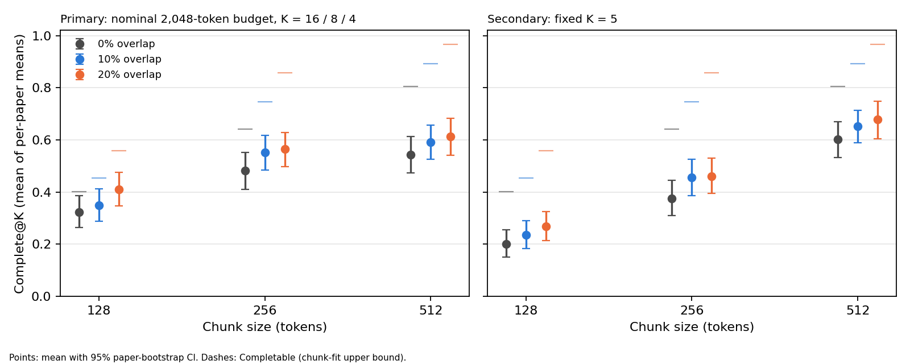

# Chunk size & overlap in RAG retrieval

A controlled, pre-registered experiment on how chunk size and chunk overlap change what a dense retriever
finds. Everything needed to check or rerun it is here: the code, the frozen protocol, the sample manifests,
the raw per-question results and the verification logs.

## The question

Once you have chosen a chunking approach, how do the chunk **size** and **overlap** change whether
retrieval delivers the evidence a question needs? The experiment measures this on 9 configurations:

- **Chunk size:** 128, 256 and 512 tokens
- **Overlap:** 0%, 10% and 20%

## Setup

| | |
|---|---|
| Corpus | 100 NLP papers drawn at random (seed 20261017) from the [QASPER](https://aclanthology.org/2021.naacl-main.365/) v0.3 dev set; 543,074 tokens, 1,732–23,245 per paper |
| Questions | 287 questions (95 factoid, 129 multi-sentence, 63 multi-part), at most 5 per paper, with human-highlighted evidence spans |
| Embeddings | [`nomic-ai/nomic-embed-text-v1.5`](https://huggingface.co/nomic-ai/nomic-embed-text-v1.5), pinned revision |
| Search | Exact cosine similarity; each question searches only its own paper |
| Primary mode | Equal token budget: 2,048 tokens per query (K = 16 / 8 / 4 chunks for 128 / 256 / 512) |
| Secondary mode | Equal K = 5, so larger chunks send more text (descriptive only) |

The sample, the grid, the metrics, the 8 comparisons and the statistical tests were written down and frozen
in [`experiment/EXPERIMENT_PROTOCOL.md`](experiment/EXPERIMENT_PROTOCOL.md) before any retrieval was run on
the sample. SHA-256 hashes of the protocol, config, manifests and code were recorded at launch in
[`experiment/manifests/frozen_at_launch.sha256`](experiment/manifests/frozen_at_launch.sha256).

## Metrics

| Metric | What it measures |
|---|---|
| **Complete@K** (primary) | Every gold evidence span lies wholly inside at least one of the top-K chunks |
| Hit@K | At least one top-K chunk overlaps the evidence |
| Evidence recall@K | Fraction of evidence tokens that appear somewhere in the top K |
| Random Hit@K | Hit@K expected from random ranking, computed exactly per question; the floor |
| Completable | Every evidence span fits wholly inside at least one chunk anywhere in the index, whatever the ranking. This is not K-aware in general. Here every completable question could be covered within its K (at most 3 chunks needed, K ≥ 4), so it is an upper bound on Complete@K |

The unit of analysis is the paper: scores are averaged within each paper, then across the 100 papers.

## Results



**Equal 2,048-token budget** (primary). Means over 100 papers, with 95% paper-bootstrap intervals:

| Size | Overlap | K | Complete@K | Hit@K | Evidence recall@K | Completable |
|---:|---:|---:|---|---|---|---:|
| 128 | 0% | 16 | 0.323 (0.263–0.386) | 0.917 (0.879–0.952) | 0.816 (0.771–0.858) | 0.401 |
| 128 | 10% | 16 | 0.350 (0.289–0.412) | 0.905 (0.862–0.943) | 0.798 (0.749–0.844) | 0.454 |
| 128 | 20% | 16 | 0.411 (0.347–0.476) | 0.884 (0.836–0.927) | 0.793 (0.743–0.841) | 0.557 |
| 256 | 0% | 8 | 0.482 (0.410–0.551) | 0.828 (0.768–0.882) | 0.744 (0.683–0.799) | 0.641 |
| 256 | 10% | 8 | 0.552 (0.485–0.618) | 0.838 (0.783–0.889) | 0.768 (0.711–0.821) | 0.746 |
| 256 | 20% | 8 | 0.564 (0.498–0.628) | 0.806 (0.748–0.861) | 0.718 (0.660–0.773) | 0.858 |
| 512 | 0% | 4 | 0.543 (0.474–0.613) | 0.758 (0.695–0.819) | 0.699 (0.635–0.762) | 0.805 |
| 512 | 10% | 4 | 0.592 (0.526–0.657) | 0.779 (0.721–0.835) | 0.712 (0.653–0.768) | 0.892 |
| 512 | 20% | 4 | 0.614 (0.541–0.684) | 0.760 (0.697–0.820) | 0.700 (0.636–0.761) | 0.966 |

**Pre-registered comparisons** on Complete@K under the equal budget. Paired sign-flip permutation test on
the 100 per-paper differences, Holm-corrected across all 8:

| Comparison | Difference (95% CI) | p (raw) | p (Holm) | Verdict |
|---|---|---:|---:|---|
| 128 / 0% vs 256 / 0% | −0.159 (−0.229 to −0.088) | <0.0001 | 0.0002 | **256 better** |
| 256 / 0% vs 512 / 0% | −0.061 (−0.126 to +0.002) | 0.065 | 0.260 | Inconclusive |
| 128: 10% vs 0% | +0.026 (−0.042 to +0.097) | 0.470 | 0.470 | Inconclusive |
| 128: 20% vs 0% | +0.087 (+0.018 to +0.156) | 0.016 | 0.109 | Inconclusive |
| 256: 10% vs 0% | +0.070 (−0.003 to +0.145) | 0.067 | 0.260 | Inconclusive |
| 256: 20% vs 0% | +0.083 (+0.014 to +0.151) | 0.021 | 0.127 | Inconclusive |
| 512: 10% vs 0% | +0.049 (−0.022 to +0.119) | 0.186 | 0.373 | Inconclusive |
| 512: 20% vs 0% | +0.071 (+0.003 to +0.137) | 0.046 | 0.228 | Inconclusive |

**What this supports.** At 0% overlap and an equal budget, 256-token chunks delivered complete evidence more
often than 128-token chunks. No other comparison survived the correction. As the protocol requires, a
non-significant difference is reported as inconclusive, not as a tie, and no configuration is declared best
for having the highest mean.

The Completable column shows why size and overlap matter here: at 128 / 0%, only 40% of questions have every
evidence span fitting whole in some chunk, so no ranking could exceed 0.40. Overlap and size raise that
bound to 0.97 at 512 / 20%, where ranking then reaches 0.61.

Full tables, including the equal-K mode, are in
[`experiment/results/fresh_v1/tables/`](experiment/results/fresh_v1/tables/).

## Verification

After the run, every reported value was recomputed independently from the saved rankings, chunk boundaries
and evidence spans by [`experiment/verify_all_fields.py`](experiment/verify_all_fields.py). It covers every
column of all 5,166 per-question rows, the per-paper and overall means, the failure counts and the
statistics: 137,175 checks, 0 mismatches
([log](experiment/results/fresh_v1_verify_all_fields.log)). [`README_AUDIT.md`](README_AUDIT.md) is a
file-by-file guide for anyone auditing the run.

## Repository layout

| Path | What it is |
|---|---|
| [`experiment/`](experiment/) | The study: code (`src/`), config, protocol, manifests, tests and results. See [`experiment/README.md`](experiment/README.md) |
| [`experiment/results/fresh_v1/`](experiment/results/fresh_v1/) | The confirmatory run: raw per-question results, full rankings, aggregates, statistics, tables, figures |
| [`experiment/EXPERIMENT_PROTOCOL.md`](experiment/EXPERIMENT_PROTOCOL.md) | The frozen design and analysis plan; §10 logs every change made after launch |
| [`protocol_history/`](protocol_history/) | The protocol as frozen at launch, and its diff against the current version |
| [`README_AUDIT.md`](README_AUDIT.md) | Guide for auditors: verification logs, hashes, how the at-launch protocol was recovered |
| `eval.jsonl`, `corpus/`, `prepare_qasper.py`, `count_funnel.py`, `results/budget2048/` | Inputs from an earlier 40-paper pilot. The fresh sample excludes the pilot's papers, and the regression tests check the new code against the pilot's outputs. The pilot's own results are not reported: an audit found its held-out questions had influenced the design |

## Reproducing

Requirements: Python 3.11+ (tested on 3.14.2) and the pinned packages in
[`experiment/requirements.txt`](experiment/requirements.txt). From `experiment/`:

```
pip install -r requirements.txt

# QASPER v0.3 train/dev
mkdir -p ../data/qasper_raw
curl -L -o ../data/qasper_raw/qasper.tgz https://qasper-dataset.s3.us-west-2.amazonaws.com/qasper-train-dev-v0.3.tgz
tar -xzf ../data/qasper_raw/qasper.tgz -C ../data/qasper_raw

python -m unittest discover -s tests -t .                       # 36 unit and regression tests

# check the published results
python verify_all_fields.py --run results/fresh_v1

# rerun from scratch
python run_experiment.py run --sample fresh --out results/fresh_v1_repro --approved-full-run
python run_experiment.py analyze --run results/fresh_v1_repro
python run_experiment.py verify  --run results/fresh_v1_repro
```

The first run downloads the embedding model (about 547 MB). The published run took about 2 hours 10 minutes
on a CPU, with embeddings for three of the nine configurations already cached.

## Data and attribution

QASPER: Dasigi, Lo, Beltagy, Cohan, Smith, Gardner. *A Dataset of Information-Seeking Questions and Answers
Anchored in Research Papers.* NAACL 2021. Released by the Allen Institute for AI under CC BY 4.0. The
question text and evidence spans in `eval.jsonl`, `corpus/` and `experiment/results/*/raw/questions.jsonl`
are derived from it.
